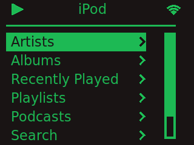
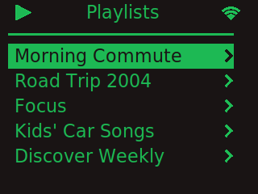
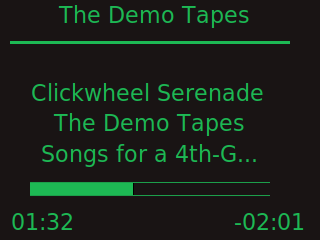

# sPot Revival

**Spotify in a 4th-generation iPod, rebuilt for 2026.** A Raspberry Pi Zero 2 W (or Zero W)
inside an iPod "Click Wheel" (model A1059) case, driven by the original click wheel, with
haptic feedback, Spotify Connect playback and your Spotify library on a tiny screen.

<p align="center">
  
  
  
</p>
<p align="center"><sub>Screenshots of the real UI code rendered with demo data by
<code>tools/ui_preview.py</code> (not photos of hardware).</sub></p>

This repository continues [Guy Dupont's sPot](https://hackaday.io/project/177034-spot-spotify-in-a-4th-gen-ipod-2004)
(2021). The 2021 software no longer works as written: Raspotify dropped the Pi Zero W's
ARMv6 CPU, Spotify removed password logins, and in 2026 Spotify restricted the Web API for
personal ("Development Mode") apps. The software here is based on
[oliver-vv/Spotify-iPod-Classic](https://github.com/oliver-vv/Spotify-iPod-Classic), which
already solved those problems, and adds support for **the original sPot hardware**
(Adafruit composite display) and the **Pi Zero W**, plus a complete build guide.

## Start here

**[Build guide](docs/guide/README.md)** - parts, Spotify setup, bench test on a Pi 3,
wiring, power, assembly, first boot, troubleshooting. Written so someone who has never
built one can follow it step by step.

**[Wiring diagrams](docs/wiring/README.md)** - schematics, harness diagram, pin tables,
with the source for every connection.

## What runs on the Pi

```
click wheel --(GPIO, pigpio)--> clickwheel/click.c --UDP 127.0.0.1:9090--> frontend/spotifypod.py (tkinter UI)
                                                                              |-- go-librespot :3678 (Spotify Connect, audio)
                                                                              |-- Spotify Web API (library/search, PKCE login)
                                                                              `-- SQLite cache
phone --> http://ipod.local (portal/: Spotify linking, Bluetooth pairing, power)
```

## Supported hardware

| Part | Status |
|---|---|
| Raspberry Pi Zero 2 W | Recommended. 64-bit Raspberry Pi OS Lite. |
| Raspberry Pi Zero W / Zero | Supported via go-librespot's ARMv6 build; 32-bit OS; slower UI. |
| Raspberry Pi 3 / 4 | Bench testing only (does not fit the case). Same 64-bit image as the Zero 2 W. |
| Display: Adafruit #911 2" NTSC/PAL TFT (original sPot) | `DISPLAY_PROFILE=composite` (default). |
| Display: Waveshare 2" ST7789V SPI (Ricardo Sappia's build) | `DISPLAY_PROFILE=st7789` (upstream oliver-vv path). |
| iPod 4th gen (A1059) click wheel, 8-pin FPC | Required. Other generations use different connectors. |

## Status - read this

* Verified in software (CI): the click wheel program compiles against pigpio; the
  boot-config script is tested against fixture `config.txt`/`cmdline.txt` files; the
  Web API parsing is tested against Spotify's 2026 response shapes; the UI renders at
  320x240 and 720x480 (composite) with demo data.
* **Not yet verified on hardware by this repository.** The hardware approach follows the
  original sPot, and the software path follows oliver-vv's fork (built on a Zero 2 W with
  an SPI panel) and thehajime's fork (go-librespot on a Zero W). If you build one, please
  open an issue with what worked.

## Credits

This is a derivative work; the people who did the hard parts are listed in
[CREDITS.md](CREDITS.md). Changes made here are summarised in [NOTICE](NOTICE).

## Licence

Apache-2.0 ([LICENSE](LICENSE)), inherited from sPot. The Raspberry Pi pad diagram in
`docs/images/reference/` is CC BY-SA 4.0 (Raspberry Pi Ltd) - see CREDITS.md.
