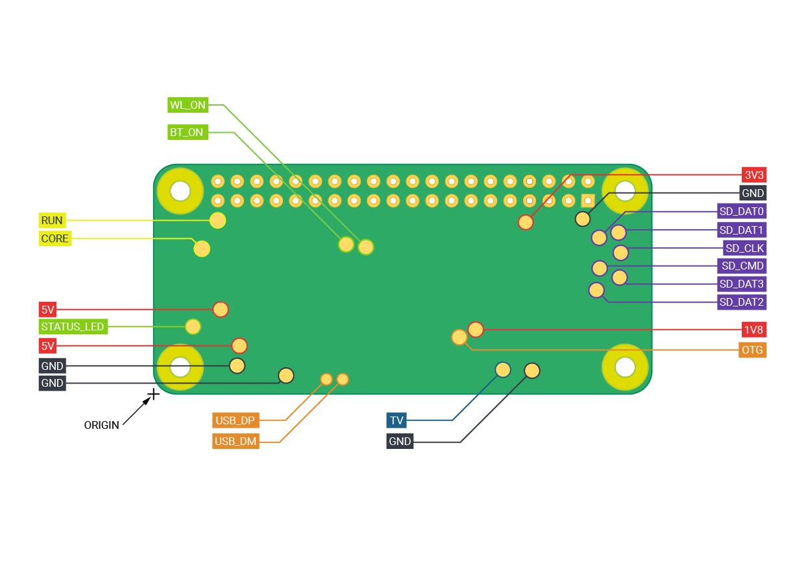

# 6. Display and haptics

## Composite display (Adafruit #911)

Diagram: [../wiring/03-composite-display.svg](../wiring/03-composite-display.svg)

The #911 driver board has a 4-wire cable: **red = V+ (pin 1), black = GND (pin 2), a
second GND (pin 3) and composite video (pin 4)**; the colours of the last two vary
([Adafruit](https://www.adafruit.com/product/911)). Adafruit's advice for finding them: the
wire next to the black power wire is ground, the one at the end of the connector is video.

**Voltage:** Adafruit specifies **6-12 V** into its onboard regulator, while also listing
120 mA draw at 5 V. The original sPot powered it from the 5 V rail and it worked. If your
screen flickers or stays dark on 5 V, that is the first suspect.

### Video connection

Cut the RCA plug off the display cable.

* **Pi Zero W:** solder video to the hole marked **TV** next to the GPIO header (the square
  pad) and video ground to the round pad beside it - this is what the original sPot diagram
  shows.
* **Zero 2 W:** there are no TV holes; composite is on two test pads on the **underside**,
  labelled TV and GND, near the mini-HDMI end. Official coordinates: TV at (45.58, 3.17) mm,
  GND at (49.38, 3.05) mm from the board origin.
  
  Raspberry Pi Zero 2 W test pad diagram, Raspberry Pi Ltd, CC BY-SA 4.0.

### Display power (desk test)

Until the battery is wired (chapter 7), power the display from the Pi: red to pin **2**
(5 V), black to pin **6** (GND), with the Pi on its micro-USB supply.

Composite is used when no HDMI display is detected (Raspberry Pi config.txt docs), so
keep the mini-HDMI port empty. Reboot.

**Check:** the setup screens or the iPod menu fill the display. If the edges are clipped,
reduce `FIT_MARGIN` in `frontend/spotifypod.py`; to switch NTSC/PAL re-run the installer
with `TV_NORM=PAL`.

## Haptic motor

Diagram: [../wiring/02-haptic-driver.svg](../wiring/02-haptic-driver.svg)

Build this on a scrap of perfboard: GPIO 26 (pin 37) -> 220 ohm -> base of a 2N3904;
emitter to GND (pin 39); collector to the motor's negative lead; motor positive to +5 V.
This is the original sPot circuit. Add a **1N4148 across the motor, cathode (striped end)
to +5 V** - Guy Dupont later said the lack of a flyback diode probably caused occasional
issues in his build.

Check the 2N3904 pinout in your part's datasheet (for the common TO-92 package, flat side
facing you, legs down: emitter, base, collector). Many 10x2 mm motors are rated around 3 V;
sPot pulsed one from 5 V for 8 ms at a time. If yours runs hot or loud, power it from 3.3 V
instead (pin 17).

`click.c` pulses the motor every second wheel step. Build without it by adding
`-DNO_HAPTIC` (or just leave the motor off).

**Check:** turning the wheel produces short buzzes.
