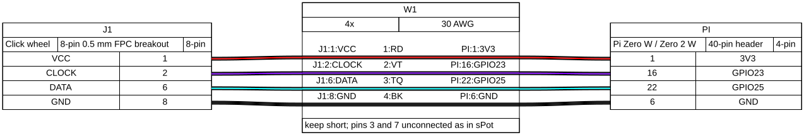
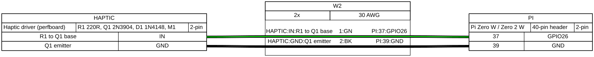
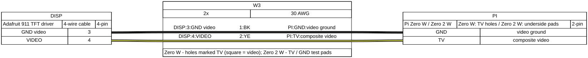
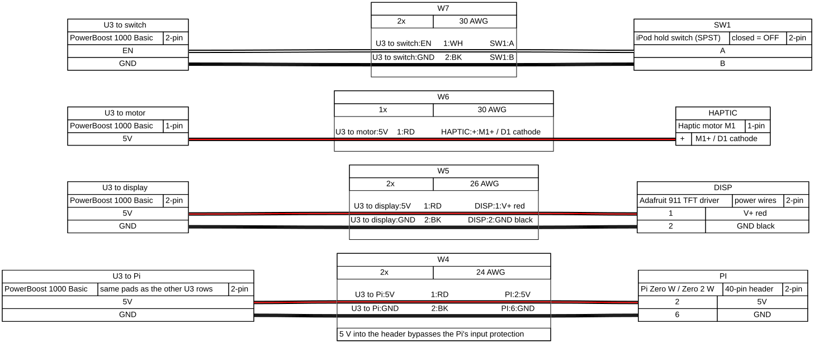
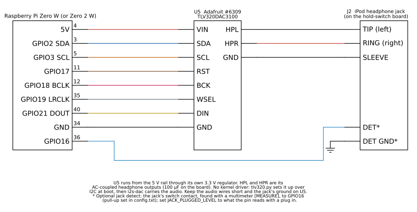

# Wiring

Start with the header map: it shows every header pin you solder to. Then each subsystem
has a schematic (what connects to what) and a harness drawing (the wires to cut and their
colours). Every diagram comes in a light and a dark version; the page shows the one that
matches your theme.

All diagrams are generated from source in
[`docs/wiring/src/`](https://github.com/trystendsmyth/retro-ipod-spotify-revival/tree/main/docs/wiring/src)
so they can be corrected and re-rendered. The tools are pinned so the files come out
byte-identical, and CI fails if the committed files differ from a fresh render:

```bash
sudo apt install graphviz                         # Ubuntu 24.04 / Debian, for WireViz
pip install -r docs/wiring/src/requirements.txt
python3 docs/wiring/src/schematics.py
python3 docs/wiring/src/header_map.py
for f in clickwheel haptic display power audio; do
  wireviz -f ps docs/wiring/src/harness-$f.yml -o docs/wiring
done
```

## Header map

<picture>
  <source media="(prefers-color-scheme: dark)" srcset="header-map-dark.svg">
  
</picture>

Composite video doesn't use the header. On the Zero 2 W it's on test pads underneath; see
the Raspberry Pi pad diagram:
[raspberrypi-zero2-pad-diagram.png](../images/reference/raspberrypi-zero2-pad-diagram.png)
(CC BY-SA 4.0, Raspberry Pi Ltd).

## Pin table

| Signal | Pi physical pin | BCM | Other end | Source |
|---|---|---|---|---|
| Click wheel VCC | 1 (3.3 V) | - | FPC pin 1 | sPot diagram; Garr pinout |
| Click wheel CLOCK | 16 | 23 | FPC pin 2 | sPot diagram / `click.c` |
| Click wheel DATA | 22 | 25 | FPC pin 6 | sPot diagram / `click.c` |
| Click wheel GND | 6 | - | FPC pin 8 | sPot diagram |
| Haptic | 37 | 26 | R1 220 ohm -> Q1 2N3904 base | sPot diagram / `click.c` |
| Haptic GND | 39 | - | Q1 emitter | sPot diagram |
| DAC VIN | 4 (5 V) | - | U5 VIN | Adafruit #6309 guide (3.3-5 V in, onboard regulator) |
| DAC SDA | 3 | 2 | U5 SDA | Raspberry Pi pinout (I2C1); Adafruit #6309 guide |
| DAC SCL | 5 | 3 | U5 SCL | Raspberry Pi pinout (I2C1); Adafruit #6309 guide |
| DAC reset | 11 | 17 | U5 RST | free GPIO; `DAC_RESET_GPIO` in `install/install.sh` |
| I2S bit clock | 12 | 18 | U5 BCK | Raspberry Pi pinout (PCM_CLK) |
| I2S word select | 35 | 19 | U5 WSEL | Raspberry Pi pinout (PCM_FS) |
| I2S data | 40 | 21 | U5 DIN | Raspberry Pi pinout (PCM_DOUT) |
| DAC GND | 34 | - | U5 GND | |
| Jack detect (optional) | 36 | 16 | jack switch contact | free GPIO; `JACK_DETECT_GPIO` in `install/install.sh` |
| 5 V in | 2 | - | PowerBoost 5V | Hackaday details ("Pi and display run on 5V") |
| GND | 6 | - | PowerBoost GND | |
| Composite video | TV hole (Zero W, square pad) / TV pad (Zero 2 W) | - | display pin 4 | sPot diagram; Raspberry Pi docs and magazine |
| Video ground | round hole beside TV (Zero W) / GND pad (Zero 2 W) | - | display pin 3 | Raspberry Pi docs; Adafruit #911 |

For the `st7789` profile (the SPI-display build from oliver-vv's upstream, after Ricardo
Sappia's) the click wheel DATA moves to GPIO 5 (pin 29) because GPIO 25 becomes the
display RESET. Its backlight moves from GPIO 18 to GPIO 27 (pin 13), because GPIO 18 is
the I2S bit clock for wired audio. See the upstream table in
[`docs/upstream/oliver-vv-README.md`](https://github.com/trystendsmyth/retro-ipod-spotify-revival/blob/main/docs/upstream/oliver-vv-README.md).

## Click wheel

<picture>
  <source media="(prefers-color-scheme: dark)" srcset="01-click-wheel-dark.svg">
  
</picture>



## Haptic driver

<picture>
  <source media="(prefers-color-scheme: dark)" srcset="02-haptic-driver-dark.svg">
  
</picture>



## Composite display

<picture>
  <source media="(prefers-color-scheme: dark)" srcset="03-composite-display-dark.svg">
  
</picture>



## Power

<picture>
  <source media="(prefers-color-scheme: dark)" srcset="04-power-dark.svg">
  
</picture>



The PowerBoost appears once per destination in the harness drawing so that no wires cross;
every row starts at the same 5V, GND and EN pads.

## Wired audio

<picture>
  <source media="(prefers-color-scheme: dark)" srcset="05-wired-audio-dark.svg">
  
</picture>


The DAC is drawn once per destination in the harness drawing; both rows are the same
board. Sources: Adafruit's [#6309 pinouts](https://learn.adafruit.com/adafruit-tlv320dac3100-i2s-dac/pinouts)
and [schematic](https://github.com/adafruit/Adafruit-TLV320DAC3100-I2S-DAC-PCB) (HPL and
HPR pass through 100 µF coupling capacitors on the board; RST has a 10 kΩ pull-up), and the
Raspberry Pi pinout for I2S (PCM) and I2C1.

## The original sPot diagram (Guy Dupont, 2021)


Schematics 01-04 reproduce these connections; the only electrical addition there is D1.
Schematic 05 (wired audio) is new in this build.
