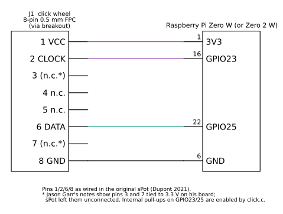
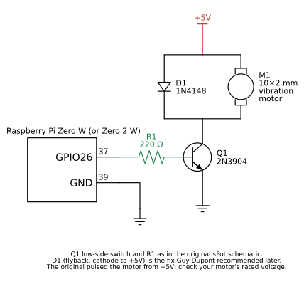
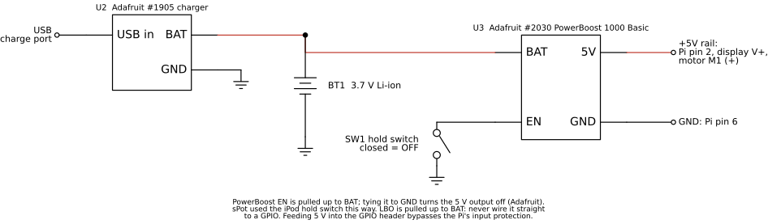
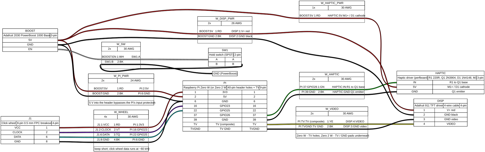

# Wiring

All diagrams are generated from source in
[`docs/wiring/src/`](https://github.com/trystendsmyth/retro-ipod-spotify-revival/tree/main/docs/wiring/src)
so they can be corrected and re-rendered:

```bash
pip install -r docs/wiring/src/requirements.txt   # plus graphviz (apt install graphviz)
python3 docs/wiring/src/schematics.py
wireviz docs/wiring/src/harness.yml -o docs/wiring && rm -f docs/wiring/harness.html
```

## Schematics (standard symbols)

Each sheet has a light and a dark version; the page shows the one that matches your
theme.

### Click wheel to Pi

<picture>
  <source media="(prefers-color-scheme: dark)" srcset="01-click-wheel-dark.svg">
  
</picture>

### Haptic driver

<picture>
  <source media="(prefers-color-scheme: dark)" srcset="02-haptic-driver-dark.svg">
  
</picture>

### Composite display

<picture>
  <source media="(prefers-color-scheme: dark)" srcset="03-composite-display-dark.svg">
  
</picture>

### Power

<picture>
  <source media="(prefers-color-scheme: dark)" srcset="04-power-dark.svg">
  
</picture>

## Harness (WireViz)



Bill of wires: [harness.bom.tsv](harness.bom.tsv).

## The original sPot diagram (Guy Dupont, 2021)


The new schematics reproduce these connections; the only electrical addition is D1.

## Pin table

| Signal | Pi physical pin | BCM | Other end | Source |
|---|---|---|---|---|
| Click wheel VCC | 1 (3.3 V) | - | FPC pin 1 | sPot diagram; Garr pinout |
| Click wheel CLOCK | 16 | 23 | FPC pin 2 | sPot diagram / `click.c` |
| Click wheel DATA | 22 | 25 | FPC pin 6 | sPot diagram / `click.c` |
| Click wheel GND | 6 | - | FPC pin 8 | sPot diagram |
| Haptic | 37 | 26 | R1 220 ohm -> Q1 2N3904 base | sPot diagram / `click.c` |
| Haptic GND | 39 | - | Q1 emitter | sPot diagram |
| 5 V in | 2 | - | PowerBoost 5V | Hackaday details ("Pi and display run on 5V") |
| GND | 6 | - | PowerBoost GND | |
| Composite video | TV hole (Zero W, square pad) / TV pad (Zero 2 W) | - | display pin 4 | sPot diagram; Raspberry Pi docs and magazine |
| Video ground | round hole beside TV (Zero W) / GND pad (Zero 2 W) | - | display pin 3 | Raspberry Pi docs; Adafruit #911 |

For the `st7789` profile (Ricardo Sappia's Waveshare build) the click wheel DATA moves to
GPIO 5 (pin 29) because GPIO 25 becomes the display RESET; see the upstream table in
[`docs/upstream/oliver-vv-README.md`](https://github.com/trystendsmyth/retro-ipod-spotify-revival/blob/main/docs/upstream/oliver-vv-README.md).
